# Multi-Cloud Identity Logging with Microsoft Sentinel (NIST 800-171 Mapped)

**Status:** ✅ Built and tested

🎥 **Video Walkthrough:** _Coming soon_

---

## Project Overview

A company running Azure, AWS, and GCP, with a fast-growing workforce and CMMC obligations, has the same question every time an auditor or an incident shows up: *who did what, in which cloud, and can we prove it?* When identity logs live in three separate consoles, that answer takes days and has gaps.

In this lab I built one place to answer it. Entra ID sign-in and audit logs, the Azure Activity Log, and AWS CloudTrail all land in a single Microsoft Sentinel workspace. On top of that I wrote five KQL detections for identity risks that matter in a regulated environment: password spraying, privileged role use, standing admin access created outside PIM, AWS identities created outside central governance, and a cross-cloud leaver check. Every log source and detection is mapped to the NIST SP 800-171 requirement it provides evidence for.

The AWS side reuses my [Entra ID → AWS IAM Identity Center SSO + SCIM lab](https://github.com/gavinbarbee/azure-entra-aws-sso-scim), so the same people who sign in through Entra show up in both log streams.

### Skills Demonstrated

- Microsoft Sentinel and Log Analytics workspace design (ingestion cap, retention)
- Entra ID diagnostic settings (sign-in and audit log export)
- AWS CloudTrail → S3 → SQS ingestion into Sentinel with an OIDC-federated IAM role (no AWS access keys)
- KQL detection engineering, including a cross-cloud join between Entra and AWS logs
- Sentinel scheduled analytics rules deployed as code
- Mapping technical controls to NIST SP 800-171 / CMMC Level 2
- Terraform (azurerm + aws providers) across two clouds

---

## Architecture Diagram

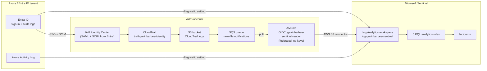

---

## Prerequisites

- Azure subscription in the **same tenant** as the Entra ID logs you want to collect
- Entra ID P1 or P2 license (required to export sign-in logs)
- Global Administrator or Security Administrator in the tenant (for the Entra diagnostic setting) and Owner/Contributor on the subscription
- AWS account with IAM Identity Center already federated to Entra ID (from my [SSO + SCIM lab](https://github.com/gavinbarbee/azure-entra-aws-sso-scim))
- Azure CLI, AWS CLI, and Terraform installed; working in PowerShell on Windows

---

## Naming Conventions

| Resource | Name |
|---|---|
| Resource group | `rg-gavinbarbee-sentinel` |
| Log Analytics workspace | `log-gavinbarbee-sentinel` |
| Entra diagnostic setting | `diag-gavinbarbee-entra-to-sentinel` |
| Activity Log diagnostic setting | `diag-gavinbarbee-activity-to-sentinel` |
| Analytics rules | `gavinbarbee-<detection-name>` (display names prefixed `GB -`) |
| CloudTrail trail | `trail-gavinbarbee-identity` |
| S3 bucket | `s3-gavinbarbee-cloudtrail-<account-id>` |
| SQS queue | `sqs-gavinbarbee-cloudtrail` |
| IAM role | `OIDC_gavinbarbee-sentinel-reader` (the connector requires the `OIDC_` prefix) |
| IAM role policy | `policy-gavinbarbee-sentinel-read` |

---

## Project Steps

### Step 1: Confirm the tenant behind my subscription

Entra ID can only send its logs to a workspace in a subscription linked to the same tenant. My lab tenant (`gavinbarbeeyahoo.onmicrosoft.com`) looked like it had no subscription, because its admin account couldn't see one. Before building anything I checked which tenant my subscription actually belongs to:

```powershell
az account list -o table
(Invoke-RestMethod "https://login.microsoftonline.com/gavinbarbeeyahoo.onmicrosoft.com/v2.0/.well-known/openid-configuration").issuer
```

The issuer URL returned the same tenant ID as my subscription. The lab tenant *is* the default directory behind my subscription; the admin account simply had no role on it. So the workspace and the Entra logs live in one tenant, with no cross-tenant workaround needed.

### Step 2: Deploy the Sentinel workspace and diagnostic settings

```powershell
cd terraform\azure
Copy-Item terraform.tfvars.example terraform.tfvars   # then set subscription_id
terraform init
terraform plan "-out=main.tfplan"
terraform apply main.tfplan
```

This creates the resource group, the workspace (1 GB/day ingestion cap, 90-day retention), onboards Sentinel, and sends Entra ID sign-in and audit logs plus the subscription Activity Log to the workspace. Analytics rules are switched off on this first apply (see Step 9).

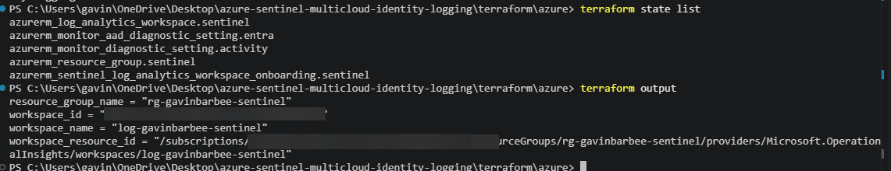

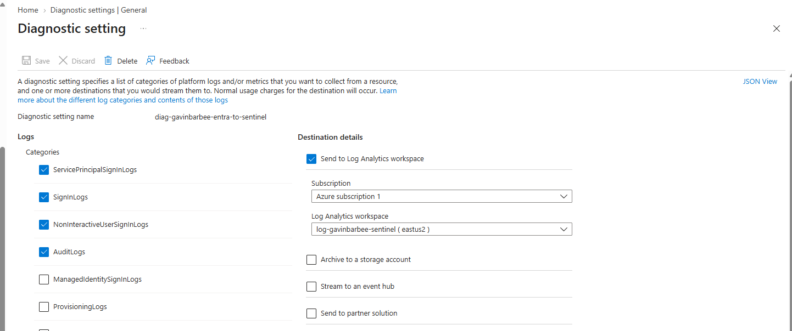

### Step 3: Verify Entra logs are arriving

In the workspace's **Logs** blade:

```kql
union SigninLogs, AuditLogs
| summarize Events = count() by Type, bin(TimeGenerated, 1h)
```

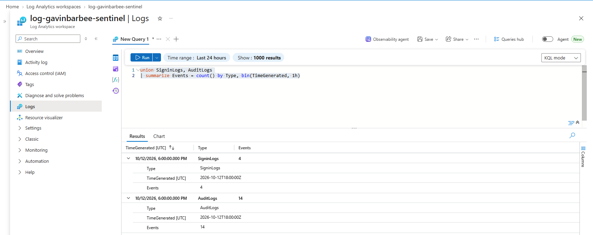

### Step 4: Deploy the AWS side (CloudTrail, S3, SQS, federated role)

To authenticate Terraform to AWS I used temporary role credentials from the IAM Identity Center access portal (`ps-gavinbarbee-admin`), not an IAM user. In the access portal under **Access keys**, I copied the PowerShell environment variables into a single PowerShell session. They expire on their own and only exist in that one session, so no long-lived AWS access keys were created or saved anywhere.

```powershell
$env:AWS_ACCESS_KEY_ID     = "<from access portal>"
$env:AWS_SECRET_ACCESS_KEY = "<from access portal>"
$env:AWS_SESSION_TOKEN     = "<from access portal>"
```

```powershell
cd ..\aws
aws sts get-caller-identity   # confirms the AWSReservedSSO_ps-gavinbarbee-admin role
Copy-Item terraform.tfvars.example terraform.tfvars   # set aws_account_id and sentinel_workspace_id
terraform -chdir=..\azure output -raw workspace_id     # value for sentinel_workspace_id
terraform init
terraform plan "-out=main.tfplan"
terraform apply main.tfplan
terraform output
```

This creates a multi-region CloudTrail trail with log file validation, an encrypted private S3 bucket, an SQS queue that receives a message each time a new log file lands, and an IAM role that Sentinel assumes through OIDC federation. The role's trust policy only accepts sessions for my specific workspace, and its permissions are read-only on that one bucket and queue. No AWS access keys exist anywhere in this design.

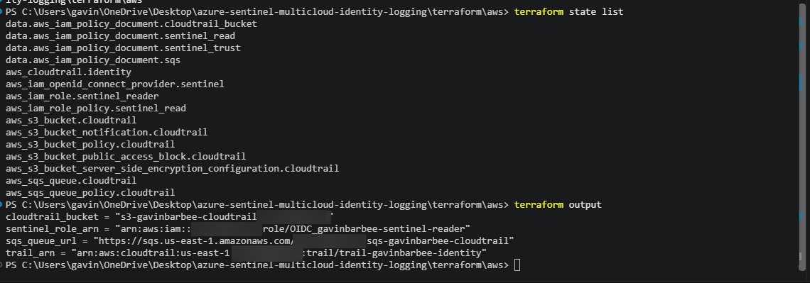

### Step 5: Connect Sentinel to AWS

Microsoft Sentinel now lives in the Microsoft Defender portal (security.microsoft.com), so both paths start under **Microsoft Sentinel** in the left nav there:

1. **Microsoft Sentinel** → **Content hub** → install the **Amazon Web Services** solution.
2. **Microsoft Sentinel** → **Data connectors** → **Amazon Web Services S3** → add a new collector with the `sentinel_role_arn` and `sqs_queue_url` outputs, data type **CloudTrail**.

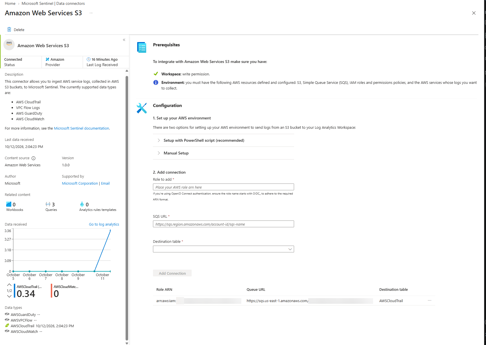

### Step 6: Verify CloudTrail logs are arriving

The first rows to arrive were already identity events:

- **`AssumeRoleWithWebIdentity`**: Sentinel assuming `OIDC_gavinbarbee-sentinel-reader` through OIDC federation to read the bucket and queue. This is the connector itself showing up in CloudTrail, with no access keys involved.
- **`identitystore-scim` `ListUsers` / `ListGroups`**: Entra's SCIM provisioning service calling AWS IAM Identity Center on its sync cycle.

To confirm the events the AWS detections depend on were landing, I filtered to console sign-ins and IAM user changes:

```kql
AWSCloudTrail
| where TimeGenerated > ago(3h)
| where EventName in ("ConsoleLogin", "CreateUser", "DeleteUser")
| project TimeGenerated, EventName, UserIdentityArn
| order by TimeGenerated asc
```

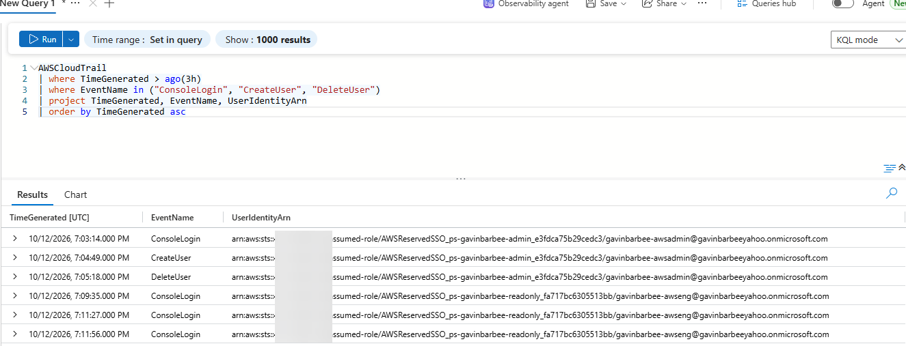

### Step 7: Generate identity activity in both clouds

- **Password spray:** one wrong-password sign-in each for `gavinbarbee-awsnoaccess` (Morgan), Paige Pilot, and jlee, all from the same IP
- **PIM activation:** Eli Employee activated an eligible role through PIM with a justification
- **Role assigned outside PIM:** Morgan was assigned **Security Reader** directly through the Microsoft Graph `roleAssignments` API (bypassing PIM), then the assignment was removed
- **IAM user outside Identity Center:** Casey created IAM user `test-gavinbarbee-localuser` in the AWS console, then deleted it
- **Leaver:** Avery was re-added to `grp-gavinbarbee-aws-engineers` so she had AWS access again, then signed in to the AWS access portal and was disabled in Entra while that session was still open (Step 8)

### Step 8: Inspect the raw events: the leaver finding

Before turning detections on, I looked at the actual events from Step 7 to confirm the operation names and fields each query depends on match my data. The leaver test produced the most important finding of the lab.

**What happened (all times UTC):**

| Time | Event |
|---|---|
| 19:09:35 | Avery opens the AWS console from her access portal session (`ConsoleLogin`) while still enabled |
| 19:10:12 | Avery disabled in Entra. Logged in `AuditLogs` twice: as **Disable account** and as **Update user** with `AccountEnabled` changing `true` → `false` |
| 19:11:27 | Avery's already-open AWS access portal session opens the AWS console (`ConsoleLogin`) |
| 19:11:56 | Opens the AWS console again from the same session |
| 19:13:44 | Opens the AWS console a third time from the same session |

Disabling her in Entra blocked new Entra sign-ins, but it did nothing to the AWS access portal session she already had. That session kept handing out console sign-ins after she was "terminated."

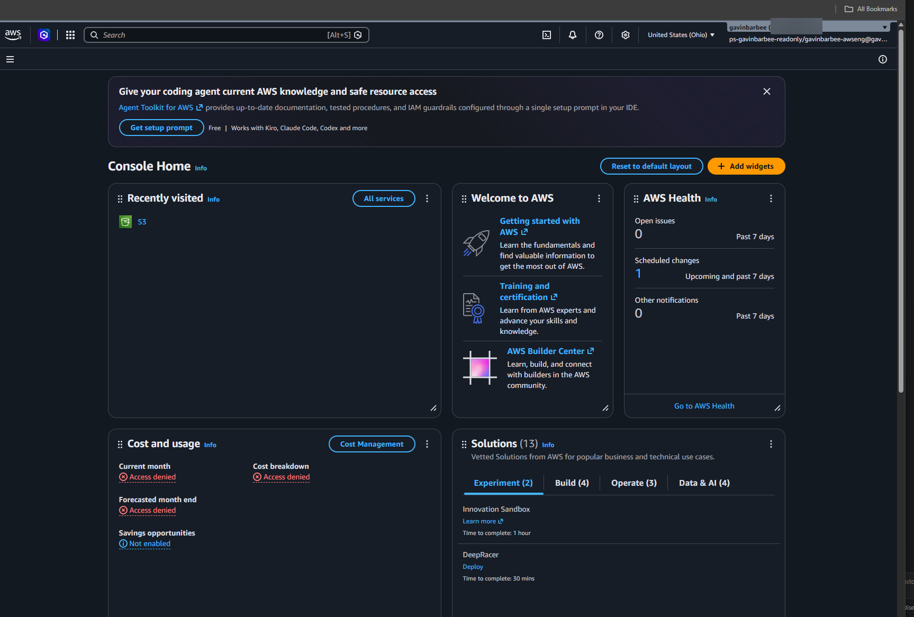

**The join key:** for an Identity Center console sign-in, the CloudTrail `UserIdentityArn` is `assumed-role/AWSReservedSSO_<permission set>_<suffix>/<username>`, and the last segment is the full Entra UPN (SCIM maps the UPN to the AWS `userName`). That's what [detection 05](detections/05-aws-console-login-after-entra-disable.kql) joins on against the `AuditLogs` disable event. When I ran it by hand at 19:19 it returned two sign-ins, at 19:11:27 and 19:11:56. The 19:13:44 sign-in hadn't been ingested yet. The alert in Defender later showed all three.

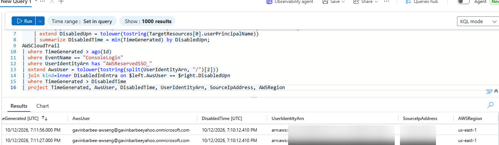

**Leaver runbook (what actually ended her access):**

1. Disable the user in Entra.
2. In the Entra enterprise app for AWS IAM Identity Center → **Provisioning** → **Provision on demand** for that *user*. This pushed `active` → `false` to AWS immediately instead of waiting for the next SCIM cycle.
3. In IAM Identity Center → **Users** → the user → **Active sessions**, delete the session. This signed her out of the AWS console in every open tab.

### Step 9: Deploy the analytics rules

Sentinel validates a rule's query when the rule is created, so a rule that references a table with no data yet fails. With data confirmed in both clouds, I flipped the flags in `terraform\azure\terraform.tfvars`:

```hcl
deploy_entra_rules = true
deploy_aws_rules   = true
```

```powershell
cd ..\azure
terraform plan "-out=main.tfplan"
terraform apply main.tfplan
```

| # | Detection | Severity | What it catches |
|---|---|---|---|
| 1 | [Password spray](detections/01-password-spray.kql) | Medium | One IP failing sign-in across 3+ accounts in 30 minutes |
| 2 | [PIM activation](detections/02-pim-activation.kql) | Informational | Every just-in-time elevation, with actor, role, and justification |
| 3 | [Role assigned outside PIM](detections/03-role-assigned-outside-pim.kql) | High | Standing privileged access that bypasses PIM |
| 4 | [AWS IAM user outside Identity Center](detections/04-aws-iam-user-outside-identity-center.kql) | Medium | AWS identities Entra doesn't govern |
| 5 | [AWS console sign-in after Entra disable](detections/05-aws-console-login-after-entra-disable.kql) | High | Access that outlives a termination, across clouds |

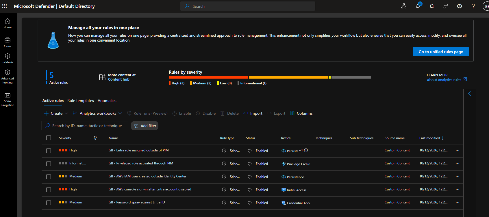

### Step 10: Review the incidents

All five rules fired on the real test data from Step 7, creating six incidents (two for the leaver rule). The leaver rule runs every hour (`PT1H`) but looks back one day (`P1D`), so a later run matched the same three sign-ins again and opened a second incident. Incidents appear in the Microsoft Defender portal under **Incidents & alerts**.

The role-assigned-outside-PIM rule firing confirms that a role assigned directly through the Graph API is logged as a direct assignment, not by MS-PIM, which is exactly the gap detection 03 is meant to catch.

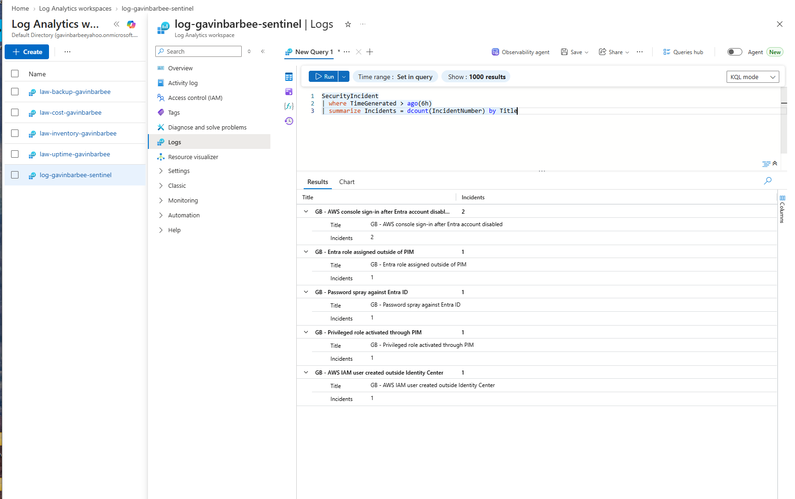

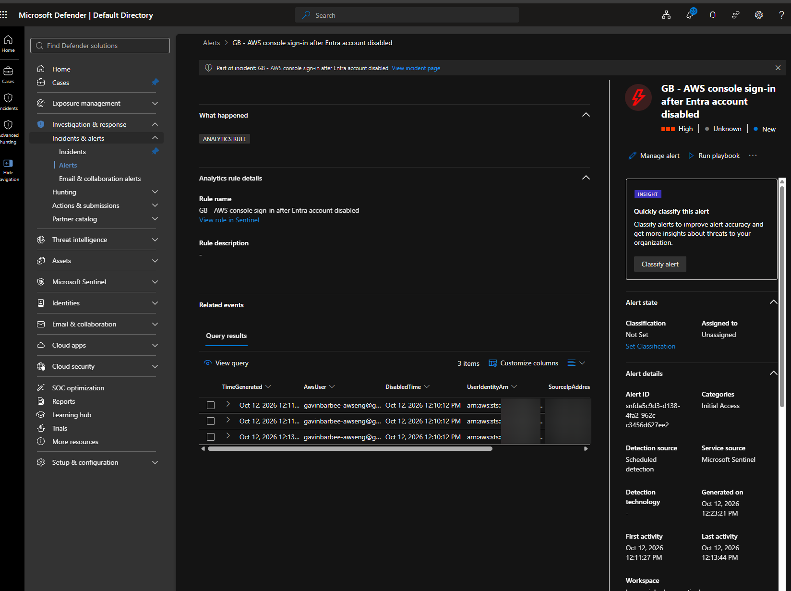

### Step 11: Map everything to NIST SP 800-171

CMMC Level 2 is built on the 110 requirements in NIST SP 800-171 Rev 2. This table shows which requirements each part of the lab provides evidence for. It's evidence toward those requirements, not a claim that the requirements are fully met.

| Component | NIST SP 800-171 requirement | How it provides evidence |
|---|---|---|
| Entra sign-in logs | 3.3.1, 3.3.2 | Records every authentication, tied to an individual user |
| Entra audit logs | 3.3.1, 3.1.7 | Records directory changes, including privileged operations |
| AWS CloudTrail (with log file validation) | 3.3.1, 3.3.2, 3.3.8 | Records AWS actions per user; validation detects tampering with log files |
| One workspace for both clouds | 3.3.5 | Correlates audit review across clouds in one place |
| Detection 1: Password spray | 3.1.8, 3.14.6 | Monitors failed logons and flags an attack pattern |
| Detection 2: PIM activation | 3.1.7 | Captures execution of privileged functions |
| Detection 3: Role outside PIM | 3.1.5, 3.1.7 | Flags privileged access granted outside least-privilege controls |
| Detection 4: IAM user outside Identity Center | 3.5.1, 3.14.7 | Flags identities outside central identification and unauthorized use |
| Detection 5: Sign-in after disable | 3.9.2, 3.1.1 | Verifies access is removed after termination, across clouds |

**Design notes (not built in this lab):**
- **GCP:** the same pattern extends with Cloud Audit Logs exported to Pub/Sub and Sentinel's GCP connector.
- **Azure Government (GCC High):** Gov cloud is a separate boundary with its own tenants and endpoints, and the Sentinel connector values differ. Whether Gov logs stay in a Gov workspace or feed a central SIEM is a boundary and compliance decision, not just a technical one.

---

## Verification Checklist

- [x] Workspace deployed with a 1 GB/day ingestion cap and Sentinel onboarded
- [x] `SigninLogs` and `AuditLogs` returning data
- [x] `AWSCloudTrail` returning data through the S3 connector
- [x] No AWS access keys created; connector uses the OIDC role only
- [x] All five analytics rules enabled
- [x] Each detection produced an incident from the Step 7 activity (or a documented reason it didn't)
- [x] NIST 800-171 mapping table complete

---

## Troubleshooting

| Issue | Cause | Fix |
|---|---|---|
| Admin test user couldn't sign in to AWS after being re-enabled in Entra | SCIM had last provisioned the user while they were disabled, so AWS still had them as `active: false`. Re-enabling in Entra doesn't reach AWS until the next sync | **Provision on demand** for the *user* (not the group) in the AWS IAM Identity Center enterprise app |

---

## Cleanup

Teardown order matters: stop the data flowing before deleting where it lands.

1. In Sentinel, remove the AWS S3 connector collector.
2. Destroy the AWS stack:
   ```powershell
   cd terraform\aws
   terraform destroy
   ```
3. Destroy the Azure stack (removes the analytics rules, both diagnostic settings, Sentinel, the workspace, and the resource group):
   ```powershell
   cd ..\azure
   terraform destroy
   ```
4. Confirm in Entra ID → **Diagnostic settings** that `diag-gavinbarbee-entra-to-sentinel` is gone.

---

## Key Takeaways

- **Disabling a user in Entra doesn't end their existing AWS session.** Avery's open access portal session opened the console three times after she was disabled. A real leaver process is disable in Entra + force a SCIM sync for the user + revoke their AWS sessions, with a detection (05) to catch anything that slips through.
- **SCIM syncs account status in both directions, but only on its cycle.** Disabling and re-enabling in Entra both reach AWS eventually; when timing matters, Provision on demand for the user is what makes it immediate.
- **Analytics rules can't be created until their tables have data.** Sentinel validates the query at creation, so I deployed the log pipelines first and turned the rules on in a second apply once both clouds were reporting.
- **The OIDC role means Sentinel reads AWS logs with no stored keys.** Its `AssumeRoleWithWebIdentity` calls show up in CloudTrail like any other identity, so even the connector's own access is auditable.
- **One workspace lets a single query join Entra and AWS identity events.** The leaver detection only works because the Entra disable event and the AWS console sign-in sit side by side, joined on the UPN.
- **When a rule's lookback is longer than its run frequency, it needs suppression or deduplication, or one event becomes repeat incidents.** The leaver rule runs hourly over a one-day window, so the same three sign-ins opened two incidents. In production I'd enable alert suppression on that rule for the length of its lookback (one day), so the same events can't open a second incident.

---

*Built by Gavin Barbee · [github.com/gavinbarbee](https://github.com/gavinbarbee) · Time to complete: ~4 hours*
